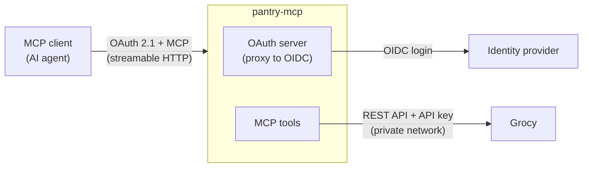

# pantry-mcp

A remote [MCP](https://modelcontextprotocol.io) server that lets an AI agent read and maintain a
[Grocy](https://grocy.info) instance: food stock, products, recipes, meal plan and shopping list.

The goal is to never open Grocy's UI again. Groceries, meals and leftovers are described to the
agent in plain language, and it keeps Grocy up to date through the tools below.

## What it looks like

| Request | What the agent does |
|---------|---------------------|
| "I just bought 6 eggs and two cans of tomatoes" | `add_to_stock` twice (cans converted to grams, the product's stock unit), reports the transaction ids |
| "What can I cook tonight?" | `recipes`: which recipes the current stock covers |
| "Add what's missing for the omelette to the list" | `add_recipe_missing_to_shopping_list` |
| "Oops, I only bought 4 eggs" | `undo` with the transaction id, then `add_to_stock` again |
| "What expires this week?" | `stock_alerts` |

## Tools

- **Read**: `stock`, `stock_alerts`, `product`, `recipes`, `recipe`, `meal_plan`, `shopping_list`,
  `query_objects` (raw rows of any Grocy entity except API keys and sessions), `system_info`.
- **Write**, taking names and units instead of ids:
  - master data: `create_product`, `create_recipe`;
  - stock: `add_to_stock`, `consume`, `open_product`, `transfer`, `inventory`, `undo`;
  - recipes, shopping list, meal plan: `cook_recipe`, `add_recipe_missing_to_shopping_list`,
    `shopping_list_add`, `shopping_list_remove`, `shopping_list_add_missing`,
    `shopping_list_clear`, `plan_meal`;
  - generic, for the rest of the API: `create_object`, `update_object`, `delete_object`.

Every tool carries MCP annotations (read-only, additive or destructive), so clients can ask for
confirmation before destructive calls.

## Architecture



- The server is its own OAuth authorization server for MCP clients (dynamic client registration,
  same origin as the MCP endpoint, as the MCP spec requires) and delegates the actual login to any
  OpenID Connect provider. Only one account (`ALLOWED_USERNAME`) may use the tools.
- Grocy is only reached over a private network with a dedicated API key: it never needs to be
  exposed to the internet.

Code layout (`src/pantry_mcp/`):

| Module | Role |
|--------|------|
| `grocy.py` | Minimal async client for the Grocy REST API |
| `lookup.py` | Name resolution and quantity unit conversions, shared by reads and writes |
| `pantry.py` | Read operations, rendered as compact text for the model |
| `actions.py` | Write operations |
| `server.py` | MCP tools, their descriptions and annotations, auth and configuration |

## Design notes

- **Exact names for writes.** Reads accept a unique partial name; writes only accept an exact name
  (ignoring case) or an id, so that "milk" never silently targets "coconut milk". Names are
  compared in Python, because SQLite's `LIKE` only ignores case for ASCII letters ("Œufs" vs
  "œufs").
- **Amounts in any unit.** Grocy stores every amount in the product's stock unit; the unit next to
  an amount is only for display. Tools accept an amount in any unit the product has a conversion
  for, convert it to the stock unit, and render results the way Grocy's own UI does.
- **The stock unit is chosen once.** Grocy forbids changing it after the product has been in
  stock, so `create_product` asks for it explicitly, with optional purchase unit and factor.
- **No silent "due today".** `add_to_stock` refuses a product without a default shelf life unless
  a best before date is given: Grocy would otherwise use today's date and flag it as due at once.
- **No half-written recipes.** `create_recipe` resolves every ingredient before writing anything,
  and deletes what it created if Grocy fails midway (Grocy does not cascade recipe deletions to
  ingredients).
- **Undo.** Stock changes return Grocy's transaction id, which `undo` reverts.
- **Rules live in the tool descriptions.** Some MCP clients pass tool descriptions to the model
  but not the server instructions, so every rule a tool depends on (exact names, units, undo) is
  repeated in its description. Deployment-specific conventions (`PANTRY_INSTRUCTIONS`) are
  appended the same way.
- **Credentials stay out of reach.** `query_objects` and the generic write tools refuse Grocy's
  API keys and sessions.

## Configuration

Environment variables (see `.env.example`):

| Variable | Required | Description |
|----------|----------|-------------|
| `BASE_URL` | yes | Public HTTPS URL of the server; the MCP endpoint is `$BASE_URL/mcp` |
| `GROCY_URL` | yes | Grocy base URL, as reached from the server |
| `GROCY_API_KEY` | yes | Grocy API key dedicated to this server |
| `OIDC_CONFIG_URL` | yes | OpenID configuration URL of the identity provider |
| `OIDC_CLIENT_ID`, `OIDC_CLIENT_SECRET` | yes | OIDC client registered for this server |
| `ALLOWED_USERNAME` | yes | The only account allowed (`preferred_username` claim) |
| `JWT_SIGNING_KEY` | yes | Signs issued tokens and encrypts the OAuth state (`openssl rand -base64 36`) |
| `ALLOWED_REDIRECT_URIS` | no | Comma-separated redirect URI patterns MCP clients may register; empty: any client |
| `PANTRY_INSTRUCTIONS` | no | Your own conventions (language, naming, units…), appended to the instructions and to every tool description |
| `TZ` | no | Time zone used for "today" (default meal plan range) |
| `PORT` | no | Listening port (default `8000`) |

## Deployment

Prerequisites: Docker with Compose, a Grocy instance reachable from the container, an HTTPS
reverse proxy, and an OpenID Connect provider.

1. **Grocy API key**: in Grocy, user menu → Manage API keys → Add.
2. **OIDC client** at your identity provider:
   - confidential client, redirect URI `<BASE_URL>/auth/callback`;
   - scopes `openid`, `profile`, `email` and `offline_access` (without it no refresh token is
     issued, and clients are logged out when the access token expires);
   - an RS256 signing key;
   - access restricted to the account that will use the server, ideally with a second factor.
3. **Environment**:

   ```bash
   cp .env.example .env
   openssl rand -base64 36   # JWT_SIGNING_KEY
   nano .env
   ```

4. **Run**:

   ```bash
   docker compose up -d --build
   docker compose logs -f pantry-mcp
   ```

   The container listens on `127.0.0.1:8000`; point the reverse proxy for `BASE_URL` at it. If
   Grocy runs in another Compose project, attach both to a shared Docker network (in a
   `docker-compose.override.yml`, which is git-ignored) and use its service name in `GROCY_URL`.
   OAuth state (registered clients, tokens) lives in the `oauth` volume.

5. **Check**:

   ```bash
   # Grocy is reachable from the container (prints the Grocy version)
   docker compose exec pantry-mcp python -c "import os, httpx; print(httpx.get(os.environ['GROCY_URL'] + '/api/system/info', headers={'GROCY-API-KEY': os.environ['GROCY_API_KEY']}).json())"

   # Both must point to BASE_URL, not to the identity provider
   curl -s "$BASE_URL/.well-known/oauth-protected-resource/mcp"
   curl -s "$BASE_URL/.well-known/oauth-authorization-server"

   # Must return 401
   curl -s -o /dev/null -w "%{http_code}\n" -X POST "$BASE_URL/mcp"
   ```

6. **Connect a client**: add a remote MCP server with URL `<BASE_URL>/mcp` and no client
   credentials (the server supports dynamic client registration), then log in with the allowed
   account.

Update: `git pull && docker compose up -d --build`. Back up Grocy first when an update changes
write tools.

## Development

```bash
python3 -m venv .venv
.venv/bin/pip install -e '.[dev]'
.venv/bin/pytest
```

Tests run against an in-memory fake Grocy with state (`httpx.MockTransport`), with no network
access: writes are checked against the resulting rows, including the rollback paths.

Run locally without auth against a real Grocy (refused when `BASE_URL` is HTTPS), then explore the
tools with the MCP Inspector:

```bash
PANTRY_NO_AUTH=1 BASE_URL=http://localhost:8000 \
  GROCY_URL=<grocy-url> GROCY_API_KEY=<key> .venv/bin/pantry-mcp

npx @modelcontextprotocol/inspector   # connect to http://localhost:8000/mcp
```

## License

[MIT](LICENSE)
